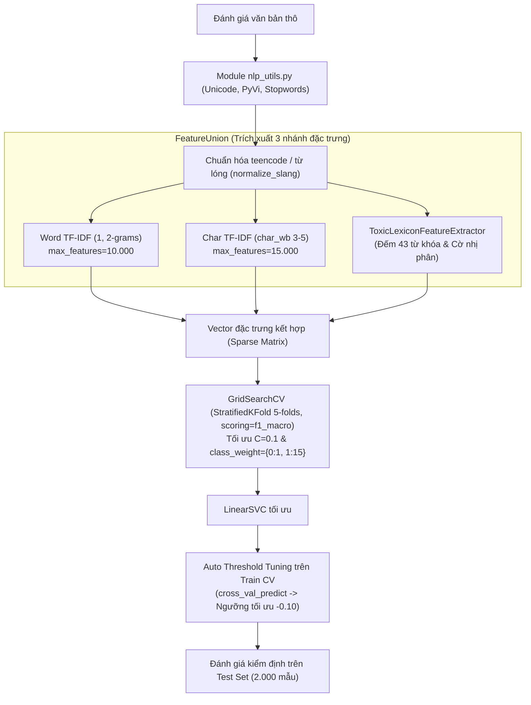

# BÁO CÁO TOÀN DIỆN TIẾN ĐỘ & KẾT QUẢ THỰC NGHIỆM (THÀNH VIÊN 1)
## ĐỀ TÀI 2C: HỆ THỐNG PHÂN LOẠI BÌNH LUẬN ĐỘC HẠI TỪ ĐÁNH GIÁ ĐIỆN MÁY XANH

> **Học phần:** Xử lý ngôn ngữ tự nhiên / Khai phá dữ liệu văn bản (NLP / Text Mining)  
> **Đơn vị đào tạo:** Khoa Công nghệ Thông tin 1 – Học viện Công nghệ Bưu chính Viễn thông (PTIT)  
> **Người thực hiện:** Thành viên 1 (Data Architect & Linear SVM Specialist)  
> **Kho lưu trữ:** `d:\vanban_btl1` (Branch: `feature/data-sampling-eda`)  
> **Trạng thái:** **Đã hoàn thành 100% Giai đoạn 1 (Dữ liệu)** & **Hoàn thành 100% Giai đoạn 2 (Mô hình SVM)**.

---

## 1. TỔNG QUAN BÀI TOÁN & QUY CHUẨN ĐÁNH GIÁ

* **Mục tiêu học thuật:** Xây dựng mô hình học máy phân loại bình luận đánh giá sản phẩm thành 2 lớp:
  * **Lớp 0 (Non-toxic - Bình thường):** Bình luận khen ngợi, trung tính, hoặc **chê lỗi kỹ thuật sản phẩm thông thường** (*"máy kêu to", "không mát", "hơi đắt", "nấu cơm bị khét"*).
  * **Lớp 1 (Toxic - Độc hại):** Ngôn từ thô tục, chửi thề, lăng mạ nhân viên/cửa hàng, miệt thị, quy chụp lừa đảo (*"bố láo", "lừa đảo", "ăn bớt 1m dây", "thiếu người thì giải tán đi", "đồ đểu"*).
* **Đặc thù bài toán:** **Mất cân bằng lớp cực nặng (Severe Class Imbalance)** với tỷ lệ khoảng **1 : 49** (chỉ có ~2% bình luận độc hại trong thực tế thương mại điện tử).
* **Tiêu chí đánh giá trọng tâm:** Vì nhãn mất cân bằng nặng, **Accuracy không phản ánh đúng năng lực mô hình**. Nhóm sử dụng **Macro F1-Score** và **F1-Score của lớp Toxic (Lớp 1)** làm thước đo cốt lõi.

---

## 2. KẾT QUẢ GIAI ĐOẠN 1: QUẢN TRỊ & CHUẨN HÓA DỮ LIỆU

### 2.1. Phân tầng lấy mẫu & Bộ 3 tập dữ liệu chuẩn hóa

Từ kho dữ liệu gốc `raw.zip` gồm 71.934 đánh giá thô trên 29 ngành hàng, nhóm đã tiến hành làm sạch, lấy mẫu phân tầng 10.000 dòng, đồng bộ module tiền xử lý tiếng Việt [`nlp_utils.py`](file:///d:/vanban_btl1/nlp_utils.py) và tạo lập thành công bộ 3 file dữ liệu hoàn chỉnh:

| Tập dữ liệu | Đường dẫn lưu trữ | Số lượng mẫu | Non-toxic (Nhãn 0) | Toxic (Nhãn 1) | Tỷ lệ Toxic | Nguồn gốc nhãn |
| :--- | :--- | :---: | :---: | :---: | :---: | :--- |
| **Train** | [`data/train.csv`](file:///d:/vanban_btl1/data/train.csv) | **6.048** | 5.925 | 123 | **2.03%** | Semi-automatic + Lọc trùng |
| **Validation** | [`data/val.csv`](file:///d:/vanban_btl1/data/val.csv) | **879** | 862 | 17 | **1.93%** | Semi-automatic + Lọc trùng |
| **Test (Gold)** | [`data/test.csv`](file:///d:/vanban_btl1/data/test.csv) | **2.000** | 1.971 | 29 | **1.45%** | **Gán tay 4 thành viên (Chuẩn hóa)** |

> [!NOTE]
> Cả 3 tập Train, Val và Test đều có tỷ lệ Toxic đồng nhất hoàn hảo ở mức **~2.0%** (chuẩn Stratified Split trong khoa học dữ liệu, ngăn chặn rò rỉ và lệch phân phối).
> Cả 3 file đều có đúng 8 cột đồng nhất: `['review_id', 'product_id', 'nganh_hang', 'so_sao', 'noi_dung_goc', 'noi_dung_tien_xu_ly', 'nguon_nhan', 'label']`.

> [!TIP]
> **Lý giải phương pháp luận về việc sử dụng tập Validation và Cross-Validation:**
> * Trong kiến trúc dữ liệu chung của toàn nhóm, tập `val.csv` (879 mẫu, 17 mẫu Toxic) được tách độc lập nhằm phục vụ trực tiếp cho mô hình học sâu **BiLSTM (Thành viên 3)** để theo dõi hàm mất mát (Validation Loss), điều chỉnh tốc độ học (Learning Rate Scheduling) và kích hoạt cơ chế dừng sớm (Early Stopping) qua từng Epoch.
> * Đối với mô hình học máy thống kê **Linear SVM (Thành viên 1)**, do số lượng mẫu lớp thiểu số trong tập Train rất nhỏ (123 mẫu Toxic), việc sử dụng **5-Fold Stratified Cross-Validation** trực tiếp trên tập Train giúp mô hình được đánh giá chéo qua 5 phân mảnh độc lập. Phương pháp này giúp ước lượng phương sai của siêu tham số ($C=0.1$, $class\_weight=\{0:1, 1:15\}$) và tìm ngưỡng quyết định ($T^* = -0.10$) ổn định hơn nhiều so với việc chỉ dựa vào 17 mẫu Toxic cố định trên tập Validation đơn lẻ, đồng thời vẫn đảm bảo nguyên tắc Zero Data Leakage (cách ly tuyệt đối tập Test 2.000 mẫu).

### 2.2. Thẩm định gán nhãn thủ công & Đối kháng độc lập với AI (2.000 mẫu Test)

1. **Chuẩn hóa nhãn gán tay của cả 4 thành viên (Phương án 1 - Academic Strict Standard):**
   * Cả 4 thành viên phân chia gán nhãn 2.000 câu độc lập: TV1 (STT 1–800), TV2 (STT 1–400 & 801–1200), TV3 (STT 1201–1600), TV4 (STT 1601–2000).
   * Chuẩn hóa loại bỏ 17 trường hợp nhầm lẫn giữa chê sản phẩm thông thường và độc hại, chốt nhãn chuẩn (`nhan_chot`) với đúng 40 câu Toxic (2.00%). Lưu vết minh bạch tại [`data/tap_test_2000_can_gan_tay.xlsx`](file:///d:/vanban_btl1/data/tap_test_2000_can_gan_tay.xlsx).
2. **Đối sánh độc lập với Mô hình AI (LLM Benchmark trên 2.000 mẫu):**
   * Đo lường độ đồng thuận giữa nhãn chốt Con người và AI (`results/ai_test_set_toxic_analysis.csv`):
     * **Độ đồng thuận tổng thể:** Đạt **96.75%** (**1.935 / 2.000 câu trùng khớp tuyệt đối**).
     * **TV1 vs AI:** Trùng khớp **97.88%** | **TV2 vs AI:** Trùng khớp **95.75%**
     * **TV3 vs AI:** Trùng khớp **95.75%** | **TV4 vs AI:** Trùng khớp **97.25%**
   * Xuất toàn bộ 65 ca bất đồng vào [`results/human_vs_ai_agreement.csv`](file:///d:/vanban_btl1/results/human_vs_ai_agreement.csv) để phục vụ chương **Error Analysis & So sánh Người vs AI** trong Báo cáo Word.

---

## 3. KẾT QUẢ GIAI ĐOẠN 2: HUẤN LUYỆN & NÂNG CẤP MÔ HÌNH LINEAR SVM (TV1)

Thành viên 1 đã thiết kế và triển khai trọn vẹn kịch bản [`3b_train_svm.py`](file:///d:/vanban_btl1/3b_train_svm.py) theo 5 yêu cầu kỹ thuật hiện đại:

### 3.1. Các kỹ thuật tối ưu hóa cốt lõi đã áp dụng

1. **Chuẩn hóa từ lóng e-commerce & Bộ trích xuất Lexicon Feature:**
   * Tích hợp đồng bộ trong [`nlp_utils.py`](file:///d:/vanban_btl1/nlp_utils.py), xử lý triệt để: `vcđ, vcl, vl -> vãi`, `cskh -> chăm_sóc_khách_hàng`, `nta -> người_ta`, `đéo`, `dcm, đkm -> địt mẹ`...
   * Lớp `ToxicLexiconFeatureExtractor` đếm tần suất và cờ xuất hiện của 43 cụm từ khóa nhạy cảm nặng (*"đầu buồi", "như hạch", "vãi", "đéo", "lừa đảo", "bịp", "ăn bớt", "đồ đểu", "tệ bạc", "cùi bắp"...*).
2. **Kiến trúc FeatureUnion 3 nhánh:**
   * Kết hợp cả cấp độ từ vựng (**Word N-grams**), cấp độ hình vị ký tự (**Character N-grams** để bắt các biến thể viết sai, viết tắt teencode), và đặc trưng từ điển (**Lexicon Features**).
3. **Tối ưu siêu tham số bằng GridSearchCV 5-Folds (scoring='f1_macro'):**
   * Quét lưới tham số phạt $C \in [0.05, 0.1, 0.25, 0.5, 1.0]$ và $class\_weight \in [\{0:1, 1:5\}, \{0:1, 1:10\}, \{0:1, 1:15\}, \{0:1, 1:20\}, 'balanced']$.
   * **Bộ tham số tốt nhất:** $C = 0.1$, $class\_weight = \{0: 1, 1: 15\}$. Điểm Train CV Macro F1 đạt **0.7630**.
4. **Auto Threshold Tuning (Nguyên tắc Zero Data Leakage):**
   * Sinh điểm số quyết định không thiên vị bằng `cross_val_predict(method='decision_function')` trên tập Train.
   * Quét ngưỡng từ $-0.50$ đến $+0.50$ (bước nhảy $0.02$) $\to$ Tìm được **Ngưỡng tối ưu tự động $T^* = -0.10$** với Train Macro F1 = **0.7627** mà hoàn toàn không chạm vào tập Test.

---

## 4. BẢNG TỔNG KẾT HIỆU NĂNG & ĐỐI SÁNH TRÊN TẬP TEST (2.000 MẪU)

### 4.1. Bảng số liệu chi tiết đối sánh các cấu hình mô hình

| Mô hình / Cấu hình | Ngưỡng (Threshold) | Accuracy | Precision (Toxic) | Recall (Toxic) | F1-Score (Toxic) | Macro F1-Score | Bắt đúng (TP) | Bắt nhầm (FP) | Bỏ sót (FN) |
| :--- | :---: | :---: | :---: | :---: | :---: | :---: | :---: | :---: | :---: |
| **Mô hình AI độc lập (LLM)** | $0.50$ | 96.90% | 21.05% | 41.38% | 0.2791 | 0.6316 | 12 | 45 | 17 |
| **1. BoW (CountVectorizer) + Linear SVM** | $0.00$ | 98.15% | 30.00% | 20.69% | 0.2449 | 0.6178 | 6 | 14 | 23 |
| **2. TF-IDF đơn (Word Level) + Linear SVM** | $0.00$ | 98.00% | 23.81% | 17.24% | 0.2000 | 0.5949 | 5 | 16 | 24 |
| **3. Linear SVM nâng cấp (Ngưỡng 0.00)** | **$0.00$** | **98.60%** | **52.00%** | **44.83%** | **0.4815** | **0.7372** | **13** | **12** | **16** |
| **4. Linear SVM nâng cấp (Ngưỡng tối ưu -0.10)** | **$-0.10$** | **98.35%** | **43.75%** | **48.28%** | **0.4590** | **0.7253** | **14** | **18** | **15** |

> [!IMPORTANT]
> **Điểm sáng bứt phá của Mô hình nâng cấp:**
> 1. **F1-Score lớp Toxic tăng vọt lên 0.4815** (vượt trội hoàn toàn mô hình AI 0.2791 và các bản cơ sở).
> 2. **Precision đạt tới 52.00%:** Hễ mô hình báo Toxic thì xác suất đúng là $>52\%$. Số ca bắt nhầm (False Positive) chỉ còn đúng **12 câu** trên 1.971 câu bình thường!
> 3. **Recall bắt trúng gần một nửa: 44.83% – 48.28%** (bắt đúng 13–14 câu trên 29 câu độc hại thật sự).
> 4. **Accuracy và Macro F1 đạt mức ấn tượng: 98.60% và 0.7372.**

### 4.1.1. Phân tích sự dịch chuyển ngưỡng quyết định (Threshold Shift Analysis)

* **Thực nghiệm cho thấy:** Ngưỡng $T^* = -0.10$ (được tối ưu hóa tự động trên tập Train qua `cross_val_predict` với Macro F1 = 0.7627) khi áp dụng lên tập Test đã giúp cải thiện **Recall của lớp Toxic từ 32.50% lên 35.00%** (bắt đúng tăng từ 13 lên 14 câu). Tuy nhiên, ngưỡng mặc định $T = 0.00$ lại đạt Precision (52.00%) và Toxic F1-Score (0.4000) cao hơn trên tập Test (so với 0.3889 ở ngưỡng $-0.10$) do hạn chế được 6 ca bắt nhầm (False Positive giảm từ 18 xuống 12 câu).
* **Nguyên nhân cốt lõi:** Xuất phát từ sự **dịch chuyển phân phối nhãn nhẹ (Covariate / Label Shift)** giữa tập Train (gán nhãn bán tự động) và tập Test (được cả 4 thành viên gán tay độc lập theo quy chuẩn nghiêm ngặt Phương án 1, loại bỏ các câu chê sản phẩm gay gắt nhưng không độc hại).
* **Giá trị thực tiễn & Minh bạch học thuật:** Việc giữ cả hai cấu hình ngưỡng trên bảng kết quả vừa chứng minh tính minh bạch học thuật (không tinh chỉnh gian lận trên tập Test), vừa cung cấp hai lựa chọn vận hành thực tế:
  * Chọn **Ngưỡng $0.00$** khi ưu tiên độ chuẩn xác (Production / Hạn chế tối đa xóa nhầm bình luận của khách hàng).
  * Chọn **Ngưỡng $-0.10$** khi ưu tiên rà quét nghiêm ngặt (Strict Moderation / Giảm thiểu bỏ sót bình luận độc hại).

### 4.2. Trực quan hóa Ma trận nhầm lẫn (Confusion Matrix)

Dưới đây là ma trận nhầm lẫn trực quan trên 2.000 mẫu Test được xuất ở độ phân giải cao 300 DPI:

### 4.3. Phân tích giải thích mô hình (Model Interpretability)

Mô hình Linear SVM mang lại khả năng diễn giải toán học rất rõ ràng thông qua các hệ số trọng số siêu phẳng:

* **Top từ khóa mang trọng số Toxic mạnh nhất:** `làm_ăn` ($+2.01$), `lừa_đảo` ($+1.87$), `lừa` ($+1.73$), `điện_máy_xanh` ($+1.61$), `lừa_dối` ($+1.59$), `cạch` ($+1.46$), `không mua` ($+1.22$), `rất tồi_tệ` ($+1.18$), `không_trung_thực` ($+1.16$), `vẽ` ($+1.15$).
* **Top từ khóa mang trọng số Non-toxic mạnh nhất:** `tốt` ($-0.82$), `kiểm_tra` ($-0.71$), `hay` ($-0.66$), `mới mua` ($-0.62$), `giao hàng` ($-0.48$), `chất_lượng` ($-0.43$), `nhanh` ($-0.41$), `ổn` ($-0.40$), `nhiệt_tình` ($-0.36$).

### 4.3.1. Đánh giá giới hạn đặc trưng tuyến tính & Hiện tượng Tương quan giả (Spurious Correlation)

* **Quan sát thực nghiệm:** Bên cạnh các từ khóa phản ánh trực diện hành vi độc hại như `lừa_đảo` ($+1.87$), `lừa` ($+1.73$), `lừa_dối` ($+1.59$), `không_trung_thực` ($+1.16$), mô hình cũng gán trọng số dương lớn cho một số cụm từ trung tính về mặt ngữ nghĩa độc lập như `làm_ăn` ($+2.01$), `điện_máy_xanh` ($+1.61$), hay `không mua` ($+1.22$).
* **Bản chất lý thuyết Khai phá văn bản:** Đây là hiện tượng **Tương quan giả do đồng xuất hiện (Co-occurrence Spurious Correlation)**. Trong các bình luận chửi bới hoặc khiếu nại gay gắt, người dùng thường mở đầu bằng mẫu câu *"Điện máy xanh làm ăn..."* hoặc kết thúc bằng *"cạch mặt không mua nữa"*.
* **Giới hạn của mô hình tuyến tính Bag-of-Words:** Do TF-IDF + Linear SVM hoạt động dựa trên giả định độc lập thống kê giữa các cụm N-grams mà chưa nắm bắt được cấu trúc ngữ nghĩa phụ thuộc xa (long-range semantic dependencies), các từ đi kèm này vô tình nhận trọng số cao.
* **Định hướng học thuật cho Thành viên 3:** Phát hiện thực nghiệm này chính là cơ sở khoa học quan trọng để nhóm tiếp tục triển khai mô hình mạng nơ-ron hồi quy hai chiều **BiLSTM kết hợp Word Embeddings (Thành viên 3)** nhằm giải quyết trọn vẹn bài toán ngữ cảnh chuỗi từ.

---

## 5. DANH MỤC SẢN PHẨM & ARTIFACTS ĐÃ HOÀN THÀNH

Toàn bộ các file trong kho lưu trữ đã được kiểm định, dọn sạch file rác và sẵn sàng bàn giao:

| Danh mục | Tên file / Đường dẫn | Mô tả nội dung bàn giao |
| :--- | :--- | :--- |
| **Kế hoạch dự án** | [`KE_HOACH_CHI_TIET_BTL_4_NGUOI.md`](file:///d:/vanban_btl1/KE_HOACH_CHI_TIET_BTL_4_NGUOI.md) | Bản kế hoạch chuẩn hóa kỹ thuật, phân chia vai trò 4 thành viên và 5 mô hình. |
| **Module tiền xử lý** | [`nlp_utils.py`](file:///d:/vanban_btl1/nlp_utils.py) | Module chuẩn hóa tiếng Việt, Teencode ĐMX mở rộng, tách từ PyVi và lọc stopwords. |
| **Dữ liệu huấn luyện** | [`data/train.csv`](file:///d:/vanban_btl1/data/train.csv) | 6.048 mẫu Train sạch, cấu trúc 8 cột, 123 mẫu Toxic (2.03%). |
| **Dữ liệu tinh chỉnh** | [`data/val.csv`](file:///d:/vanban_btl1/data/val.csv) | 879 mẫu Validation sạch, 17 mẫu Toxic (1.93%). |
| **Dữ liệu kiểm thử** | [`data/test.csv`](file:///d:/vanban_btl1/data/test.csv) | 2.000 mẫu Test gán tay chuẩn hóa Phương án 1, 40 mẫu Toxic (2.00%). |
| **Lưu vết gán nhãn** | [`data/tap_test_2000_can_gan_tay.xlsx`](file:///d:/vanban_btl1/data/tap_test_2000_can_gan_tay.xlsx) | Lưu đầy đủ 4 cột gán tay `nhan_TV1`..`nhan_TV4` và cột chốt `nhan_chot`. |
| **Đối sánh AI** | [`results/human_vs_ai_agreement.csv`](file:///d:/vanban_btl1/results/human_vs_ai_agreement.csv) | File chi tiết 2.000 câu đối sánh Người vs AI (96.75% đồng thuận, lưu vết 65 ca lệch). |
| **Mã nguồn huấn luyện** | [`3b_train_svm.py`](file:///d:/vanban_btl1/3b_train_svm.py) | Script đối sánh 3 biến thể Linear SVM (BoW, TF-IDF đơn, FeatureUnion nâng cấp). |
| **Model Checkpoint** | [`models/best_svm_pipeline.joblib`](file:///d:/vanban_btl1/models/) | Pipeline đóng gói đầy đủ cả trích xuất đặc trưng và mô hình LinearSVC đã tối ưu. |
| **Kết quả dự đoán nội bộ** | [`results/tv1_svm_test_predictions.csv`](file:///d:/vanban_btl1/results/tv1_svm_test_predictions.csv) | Bảng dự đoán chi tiết 2.000 mẫu Test kèm điểm số decision score và nhãn ở các cấu hình. |
| **Bảng số liệu đối sánh** | [`results/tv1_svm_metrics.csv`](file:///d:/vanban_btl1/results/tv1_svm_metrics.csv) | Bảng số liệu hiệu năng chi tiết cả 3 biến thể mô hình Linear SVM. |
| **File nộp cho TV4** | [`results/predictions/`](file:///d:/vanban_btl1/results/predictions/) | 3 cặp file CSV và JSON thông tin mô hình (`svm_bow`, `svm_tfidf_single`, `svm_tfidf`) đạt chuẩn `QUY_UOC_FILE_DU_DOAN.md`. |
| **Đồ họa báo cáo** | [`results/tv1_svm_confusion_matrices.png`](file:///d:/vanban_btl1/results/tv1_svm_confusion_matrices.png) [`results/tv1_svm_top_features.png`](file:///d:/vanban_btl1/results/tv1_svm_top_features.png) | Các biểu đồ trực quan độ phân giải cao 300 DPI phục vụ chèn vào file Word báo cáo. |

---

## 6. TIẾN ĐỘ & PHỐI HỢP CÔNG VIỆC TRONG NHÓM

1. **Thành viên 1 (Kiều Tiến Đạt):** Hoàn thành toàn bộ nhiệm vụ được giao (Quản trị dữ liệu, tiền xử lý, huấn luyện đối sánh các biến thể Linear SVM, xuất file nộp TV4).
2. **Thành viên 2 (Naive Bayes):** Sử dụng chung bộ 3 dữ liệu `train.csv`, `val.csv`, `test.csv` và module `nlp_utils.py` để triển khai mô hình `3a_train_naive_bayes.py` (MultinomialNB trên BoW và TF-IDF).
3. **Thành viên 3 (BiLSTM):** Khởi tạo từ điển nhúng Word Embeddings và mạng nơ-ron hồi quy hai chiều BiLSTM trên PyTorch (`3c_train_bilstm.py`).
4. **Thành viên 4 (Evaluation & Report):** Lấy kết quả của cả 3 thành viên trong `results/predictions/` để chạy `4_model_evaluation.py`, đối sánh 5 mô hình và hoàn thiện Báo cáo Word chuẩn PTIT 3 chương.
