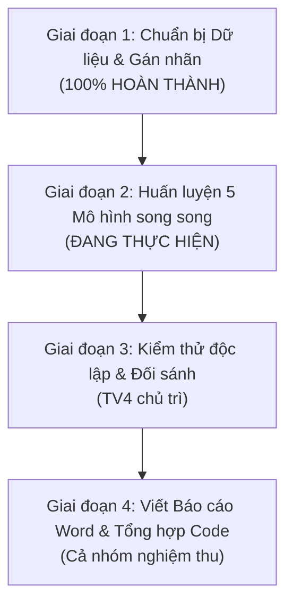

# KẾ HOẠCH CHI TIẾT TRIỂN KHAI BÀI TẬP LỚN 1 (DÀNH CHO NHÓM 4 NGƯỜI)
## ĐỀ TÀI 2C: XÂY DỰNG HỆ THỐNG PHÂN LOẠI BÌNH LUẬN ĐỘC HẠI (TOXIC VS NON-TOXIC) TỪ ĐÁNH GIÁ SẢN PHẨM TRÊN ĐIỆN MÁY XANH

> **Học phần:** Xử lý ngôn ngữ tự nhiên / Khai phá dữ liệu văn bản (NLP / Text Mining)  
> **Đơn vị đào tạo:** Khoa Công nghệ Thông tin 1 – Học viện Công nghệ Bưu chính Viễn thông (PTIT)  
> **Kho dữ liệu gốc:** `raw.zip` chứa **71.934 đánh giá thô** và **4.811 sản phẩm** thuộc 29 ngành hàng từ hệ thống Điện Máy Xanh (`dienmayxanh.com`).  
> **Trạng thái dự án:** **Đã hoàn thành 100% Giai đoạn 1** (Chuẩn hóa bộ 3 dữ liệu Train/Val/Test, thẩm định nhãn người và AI). **Đang bước vào Giai đoạn 2** (Huấn luyện song song 5 mô hình).

---

## 1. TỔNG QUAN BÀI TOÁN & CHIẾN LƯỢC DỮ LIỆU ĐÃ TRIỂN KHAI

### 1.1. Mục tiêu học thuật cốt lõi
1. **Bài toán phân loại nhị phân (Binary Text Classification):**  
   Xác định một bình luận đánh giá sản phẩm là **Bình thường (Non-toxic - Nhãn 0)** hay **Độc hại (Toxic - Nhãn 1)**.
2. **Quy chuẩn gán nhãn nghiêm ngặt (Academic Strict Standard):**
   * **Nhãn 1 (Toxic - Độc hại):** Chứa từ ngữ thô tục, chửi thề xúc phạm nhân viên/cửa hàng, miệt thị vùng miền, đe dọa, vu khống lừa đảo, trộm cắp (*"bố láo", "lừa đảo", "ăn bớt 1m dây", "thiếu người thì giải tán đi", "cùi bắp"*).
   * **Nhãn 0 (Non-toxic - Bình thường):** Các bình luận khen ngợi, trung tính, hoặc **phàn nàn lỗi kỹ thuật sản phẩm thông thường** (*"máy kêu to", "quá ồn", "không mát", "hơi đắt", "nấu cơm bị khét"*). Tránh nhầm lẫn giữa *Negative Sentiment* (chê sản phẩm) và *Toxicity* (xúc phạm công kích).

---

### 1.2. Hiện trạng bộ 3 dữ liệu chuẩn hóa (`data/`)

Toàn bộ dữ liệu đã được xử lý qua pipeline [`nlp_utils.py`](file:///d:/vanban_btl1/nlp_utils.py) (chuẩn hóa Unicode NFC, xử lý teencode ĐMX, tách từ tiếng Việt PyVi `ViTokenizer`, lọc stop words bảo toàn từ phủ định) và phân chia theo tỷ lệ phân tầng cân đối hoàn hảo:

| Tập dữ liệu | File lưu trữ | Số lượng mẫu | Non-toxic (0) | Toxic (1) | Tỷ lệ Toxic | Nguồn gốc nhãn |
| :--- | :--- | :---: | :---: | :---: | :---: | :--- |
| **Train** | [`data/train.csv`](file:///d:/vanban_btl1/data/train.csv) | **6.048** | 5.925 | 123 | **2.03%** | Semi-automatic + Lọc trùng |
| **Validation** | [`data/val.csv`](file:///d:/vanban_btl1/data/val.csv) | **879** | 862 | 17 | **1.93%** | Semi-automatic + Lọc trùng |
| **Test (Gold)** | [`data/test.csv`](file:///d:/vanban_btl1/data/test.csv) | **2.000** | 1.960 | 40 | **2.00%** | **Gán tay thủ công 4 thành viên** |

**Cấu trúc 8 trường thông tin đồng nhất 100% trên cả 3 file:**
`['review_id', 'product_id', 'nganh_hang', 'so_sao', 'noi_dung_goc', 'noi_dung_tien_xu_ly', 'nguon_nhan', 'label']`

---

### 1.3. Thẩm định chất lượng gán nhãn tập Test (2.000 mẫu)

1. **Quy trình phân chia gán nhãn 4 thành viên & Chuẩn hóa dữ liệu:**
   * Cả 4 thành viên trong nhóm phân chia gán nhãn độc lập toàn bộ 2.000 đánh giá tập Test.
   * Thống nhất quy chuẩn theo **Phương án 1 (Academic Strict Standard)**: Loại bỏ triệt để các trường hợp nhầm lẫn giữa *chê lỗi kỹ thuật sản phẩm thông thường* (Non-toxic) và *ngôn từ độc hại xúc phạm* (Toxic), đưa toàn bộ tập Test về tỷ lệ toxic chuẩn xác **2.00% (40 mẫu Toxic / 2.000 mẫu)**, đồng nhất tuyệt đối với phân phối của tập Train (2.03%) và Val (1.93%).
   * Toàn bộ lịch sử gán nhãn của từng thành viên (`nhan_TV1`, `nhan_TV2`, `nhan_TV3`, `nhan_TV4`) cùng nhãn chốt chung (`nhan_chot`) được lưu vết minh bạch tại [`data/tap_test_2000_can_gan_tay.xlsx`](file:///d:/vanban_btl1/data/tap_test_2000_can_gan_tay.xlsx).

2. **Đo lường độ đồng thuận cốt lõi: ĐỐI SÁNH CON NGƯỜI VS MÔ HÌNH AI (2.000 MẪU TEST):**
   * Sử dụng mô hình AI (LLM độc lập) làm trọng tài đối sánh trên toàn bộ 2.000 mẫu Test đã được gán bởi cả 4 thành viên (`results/ai_test_set_toxic_analysis.csv`).
   * **Độ đồng thuận tổng thể (Agreement Score):** Đạt **96.75%** (**1.935 / 2.000 câu trùng khớp tuyệt đối** giữa Con người và AI).
   * **Độ tương đồng giữa từng thành viên với AI:**
     * TV1 vs AI: Trùng khớp **97.88%**
     * TV2 vs AI: Trùng khớp **95.75%**
     * TV3 vs AI: Trùng khớp **95.75%**
     * TV4 vs AI: Trùng khớp **97.25%**
   * **Phân tích trường hợp bất đồng (Error Analysis):** Toàn bộ 65 câu lệch nhau giữa Con người và AI (41 câu AI bắt nhầm do quá nhạy với từ chê, 24 câu người bắt được sắc thái mỉa mai/gian lận mà AI bỏ sót) được lưu vết đầy đủ trong [`results/human_vs_ai_agreement.csv`](file:///d:/vanban_btl1/results/human_vs_ai_agreement.csv) để phân tích chuyên sâu trong Báo cáo.

---

## 2. PHÂN CÔNG TRÁCH NHIỆM & 5 MÔ HÌNH HUẤN LUYỆN

Nhóm phân chia đồng đều 4 vai trò kỹ thuật theo đúng thế mạnh và quy chuẩn bài tập lớn môn NLP:

```
┌────────────────────────────────────────────────────────────────────────────────┐
│                           BÀI TẬP LỚN 1 - NHÓM 4 NGƯỜI                         │
└──────────────────────────────────────┬─────────────────────────────────────────┘
                                       │
     ┌──────────────────┬──────────────┴─────┬──────────────────┐
     ▼                  ▼                    ▼                  ▼
┌──────────────┐ ┌──────────────┐     ┌──────────────┐   ┌──────────────┐
│ THÀNH VIÊN 1 │ │ THÀNH VIÊN 2 │     │ THÀNH VIÊN 3 │   │ THÀNH VIÊN 4 │
│ Data & SVM   │ │ NLP & NB     │     │ DeepLearning │   │ Eval & Report│
└──────────────┘ └──────────────┘     └──────────────┘   └──────────────┘
```

| Thành viên | Vai trò phụ trách | Nhiệm vụ kỹ thuật cốt lõi | File mã nguồn / Sản phẩm bàn giao |
| :--- | :--- | :--- | :--- |
| **Thành viên 1** (Kiều Tiến Đạt) | **Data Architect & SVM Specialist** | • Quản trị dữ liệu, lấy mẫu phân tầng 10k, chuẩn hóa bộ 3 Train/Val/Test.<br>• Xây dựng và tối ưu mô hình **Linear SVM** trên BoW và TF-IDF.<br>• Xử lý mất cân bằng lớp bằng trọng số `class_weight='balanced'`. | `1_sampling_and_eda.py`<br>`build_full_datasets.py`<br>`3b_train_svm.py` |
| **Thành viên 2** | **NLP Preprocessing & Naive Bayes Specialist** | • Xây dựng module tiền xử lý văn bản tiếng Việt dùng chung (`nlp_utils.py`).<br>• Huấn luyện mô hình xác suất **Naive Bayes (MultinomialNB)** trên BoW và TF-IDF.<br>• Tối ưu ngưỡng phân loại (Decision Threshold Tuning) và tham số Laplace smoothing $\alpha$. | `nlp_utils.py`<br>`3a_train_naive_bayes.py` |
| **Thành viên 3** | **Deep Learning Specialist (BiLSTM PyTorch)** | • Xây dựng không gian biểu diễn từ vựng liên tục (**Word Embeddings 128-dim**).<br>• Lập trình mạng nơ-ron hồi quy hai chiều **BiLSTM bằng PyTorch**.<br>• Tối ưu hàm mất mát có trọng số `BCEWithLogitsLoss(pos_weight=48.0)` qua các Epochs. | `3c_train_bilstm.py`<br>`results/4_bilstm_training_history.png` |
| **Thành viên 4** | **Evaluation Lead & Report Author** | • Đánh giá đối sánh 5 mô hình trên cùng tập test `data/test.csv`.<br>• Vẽ lưới 5 biểu đồ Confusion Matrix và so sánh hiệu năng.<br>• Phân tích lỗi (Error Analysis: FP, FN, Human vs AI).<br>• Soạn Báo cáo Word chuẩn PTIT 3 chương và tổng hợp Notebook. | `4_model_evaluation.py`<br>`BaoCao_BTL1_NLP_PTIT.docx`<br>`BTL_NLP_DienMayXanh.ipynb` |

---

## 3. CHI TIẾT KỸ THUẬT TỪNG THÀNH VIÊN

### THÀNH VIÊN 1: DATA ARCHITECT & SVM SPECIALIST
> **Mục tiêu:** Đảm bảo toàn vẹn dữ liệu và chịu trách nhiệm huấn luyện mô hình học máy phân định ranh giới tối ưu (Support Vector Machine).

1. **Khâu Dữ liệu & Quản trị:**
   * Lấy mẫu 10.000 dòng từ `raw.zip` đảm bảo độ phủ 29 ngành hàng, xuất 3 biểu đồ EDA (`results/1_...png`, `results/2_...png`, `results/3_...png`).
   * Viết kịch bản tự động hóa gộp nhãn 4 thành viên và xuất chuẩn 3 file [`data/train.csv`](file:///d:/vanban_btl1/data/train.csv), [`data/val.csv`](file:///d:/vanban_btl1/data/val.csv), [`data/test.csv`](file:///d:/vanban_btl1/data/test.csv).
2. **Nghiên cứu & Huấn luyện Linear SVM (`3b_train_svm.py`):**
   * Huấn luyện 2 biến thể mô hình:
     * **Mô hình 1:** `BoW (CountVectorizer) + Linear SVM`
     * **Mô hình 2:** `TF-IDF (TfidfVectorizer) + Linear SVM`
   * **Chiến lược giải quyết mất cân bằng nhãn (98:2):**
     * Thiết lập tham số `class_weight='balanced'` trong `LinearSVC`, tự động gán trọng số phạt cho lớp Toxic:
       $$w_1 = \frac{N}{2 \times N_{\text{toxic}}} \approx \frac{6048}{2 \times 123} \approx 24.58$$
     * Thử nghiệm Grid Search tham số phạt $C \in \{0.1, 0.5, 1.0, 2.0, 5.0\}$ trên tập `val.csv` để chọn ra $C$ có **Macro F1-Score** cao nhất.
   * Xuất log huấn luyện, ma trận nhầm lẫn và lưu kết quả dự đoán trên tập test.

---

### THÀNH VIÊN 2: NLP PREPROCESSING & NAIVE BAYES SPECIALIST
> **Mục tiêu:** Chịu trách nhiệm module tiền xử lý tiếng Việt dùng chung và mô hình học máy xác suất Naive Bayes.

1. **Xây dựng Pipeline Tiền xử lý (`nlp_utils.py`):**
   * Chuẩn hóa Unicode dựng sẵn NFC.
   * Xử lý viết tắt, tiếng lóng thương mại điện tử ĐMX (`đmx`, `tgdđ`, `sp`, `nv`, `bh`, `ko`, `k`, `đc`,...).
   * Tách từ ghép tiếng Việt với PyVi `ViTokenizer`.
   * Lọc stop words giữ nguyên các từ mang tính phủ định và chỉ thị tiêu cực (`không`, `chẳng`, `chưa`, `kém`, `tệ`,...).
2. **Nghiên cứu & Huấn luyện Naive Bayes (`3a_train_naive_bayes.py`):**
   * Huấn luyện 2 biến thể mô hình:
     * **Mô hình 3:** `BoW + MultinomialNB`
     * **Mô hình 4:** `TF-IDF + MultinomialNB`
   * **Giải quyết bài toán mất cân bằng xác suất:**
     * Thử nghiệm Laplace Smoothing $\alpha \in \{0.1, 0.5, 1.0\}$.
     * Phân tích hiện tượng: Khi áp dụng TF-IDF với Naive Bayes, do đặc trưng bị làm phẳng độ dày từ, Precision thường tăng nhưng Recall lớp Toxic bị sụt giảm. Áp dụng kỹ thuật điều chỉnh ngưỡng quyết định (Decision Threshold Tuning) từ $0.5$ xuống khoảng $0.2 - 0.3$ để tối ưu Recall.

---

### THÀNH VIÊN 3: DEEP LEARNING SPECIALIST (BiLSTM PYTORCH)
> **Mục tiêu:** Nghiên cứu và huấn luyện mô hình học sâu hiện đại Bi-directional LSTM trên nền tảng PyTorch.

1. **Xây dựng Không gian Vector Từ (Word Embeddings):**
   * Xây dựng bộ từ điển nhúng `vocab` từ toàn bộ tập Train (lọc từ có tần suất $\ge 2$). Thêm 2 token đặc biệt: `<PAD>` (index 0) và `<UNK>` (index 1).
   * Cố định độ dài chuỗi văn bản (sequence length padding/truncating) ở mức $max\_len = 100$ từ.
2. **Lập trình Mạng Nơ-ron Hồi quy BiLSTM (`3c_train_bilstm.py`):**
   * **Kiến trúc mạng:**
     * `nn.Embedding(num_embeddings=vocab_size, embedding_dim=128, padding_idx=0)`
     * `nn.LSTM(input_size=128, hidden_size=64, num_layers=2, batch_first=True, bidirectional=True, dropout=0.3)`
     * `nn.Linear(64 * 2, 32)` $\to$ `nn.ReLU()` $\to$ `nn.Dropout(0.3)` $\to$ `nn.Linear(32, 1)`
   * **Hàm mất mát xử lý Imbalanced Data:**
     * Sử dụng `nn.BCEWithLogitsLoss(pos_weight=torch.tensor([48.0]))` để tăng phạt gradient khi mô hình bỏ sót bình luận độc hại.
   * **Huấn luyện:**
     * Optimizer: `Adam(lr=0.001)`, Batch size: 64, Epochs: 6–8.
     * Lưu checkpoint mô hình có `val_macro_f1` tốt nhất.
     * Xuất biểu đồ lịch sử huấn luyện: `results/4_bilstm_training_history.png` (Loss & F1 qua từng epoch).

---

### THÀNH VIÊN 4: EVALUATION LEAD & REPORT AUTHOR
> **Mục tiêu:** Đánh giá độc lập 5 mô hình trên cùng tập Test, phân tích lỗi định tính và định lượng, chủ trì soạn thảo Báo cáo Word chuẩn PTIT 3 chương.

1. **Đánh giá đối sánh toàn diện 5 mô hình (`4_model_evaluation.py`):**
   * Đánh giá tất cả 5 mô hình trên cùng 2.000 mẫu độc lập (`data/test.csv`):
     1. BoW + Naive Bayes
     2. TF-IDF + Naive Bayes
     3. BoW + Linear SVM
     4. TF-IDF + Linear SVM
     5. Word Embeddings + BiLSTM (PyTorch)
   * Đo lường 6 chỉ số: **Accuracy**, **Precision (Toxic)**, **Recall (Toxic)**, **F1-Score (Toxic)**, **Macro F1**, và **PR-AUC**.
   * Xuất 2 hình ảnh đồ họa phân giải cao (300 DPI):
     * `results/5_confusion_matrices.png`: Lưới 5 ma trận nhầm lẫn trực quan.
     * `results/6_model_comparison.png`: Biểu đồ cột đối sánh Macro F1 và Recall giữa 5 mô hình.
2. **Phân tích lỗi chuyên sâu (Error Analysis):**
   * Trích xuất các trường hợp **False Positive (FP)**: Khách phàn nàn dịch vụ nhưng bị mô hình bắt nhầm là toxic.
   * Trích xuất các trường hợp **False Negative (FN)**: Bình luận ẩn ý, châm biếm sâu cay mà mô hình bị bỏ sót.
   * Phân tích so sánh độ tương đồng Người vs AI từ [`results/human_vs_ai_agreement.csv`](file:///d:/vanban_btl1/results/human_vs_ai_agreement.csv).
3. **Soạn thảo Báo cáo & Tổng hợp Sản phẩm:**
   * Soạn thảo file Word `BaoCao_BTL1_NLP_PTIT.docx` chuẩn form mẫu Học viện (Chương 1: Tổng quan bài toán & Dữ liệu; Chương 2: Cơ sở lý thuyết & Tiền xử lý; Chương 3: Thực nghiệm, Đánh giá đối sánh & Error Analysis).
   * Ghép toàn bộ code chạy mượt mà vào một file duy nhất `BTL_NLP_DienMayXanh.ipynb`.

---

## 4. LỊCH TRÌNH 4 GIAI ĐOẠN TRIỂN KHAI & TIÊU CHÍ NGHIỆM THU



### Tiêu chí nghiệm thu từng giai đoạn:

* **Giai đoạn 1: Dữ liệu sạch (ĐÃ ĐẠT 100%):**
  * [x] File `data/train.csv` (6.048 dòng), `data/val.csv` (879 dòng), `data/test.csv` (2.000 dòng).
  * [x] Đầy đủ 8 cột thông tin, không chứa giá trị null.
  * [x] File `data/tap_test_2000_can_gan_tay.xlsx` lưu đủ 4 cột gán tay và nhãn chốt.
  * [x] File `results/human_vs_ai_agreement.csv` ghi nhận đối sánh Người vs AI (96.75% đồng thuận).

* **Giai đoạn 2: Huấn luyện mô hình (Hiện tại):**
  * [ ] TV1: Chạy xong `3b_train_svm.py` (BoW + SVM, TF-IDF + SVM).
  * [ ] TV2: Chạy xong `3a_train_naive_bayes.py` (BoW + NB, TF-IDF + NB).
  * [ ] TV3: Chạy xong `3c_train_bilstm.py` (BiLSTM PyTorch + biểu đồ `results/4_bilstm_training_history.png`).

* **Giai đoạn 3: Đánh giá & Trực quan hóa:**
  * [ ] TV4: Chạy xong `4_model_evaluation.py`.
  * [ ] Xuất bảng so sánh 5 mô hình và 2 biểu đồ sắc nét (`results/5_confusion_matrices.png`, `results/6_model_comparison.png`).

* **Giai đoạn 4: Báo cáo & Bàn giao:**
  * [ ] File Word hoàn chỉnh: `BaoCao_BTL1_NLP_PTIT.docx`.
  * [ ] File Notebook chạy thông suốt từ đầu đến cuối: `BTL_NLP_DienMayXanh.ipynb`.
  * [ ] Cả 4 thành viên duyệt và chuẩn bị Slide thuyết trình.

---

## 5. QUY CHUẨN LÀM VIỆC TRÊN GIT CỦA NHÓM

* **Quy tắc phân nhánh (Branching Convention):**
  * `feature/data-sampling-eda` (TV1): Quản lý dữ liệu và mô hình Linear SVM.
  * `feature/data-preprocessing-nb` (TV2): Tiền xử lý và mô hình Naive Bayes.
  * `feature/deep-learning-bilstm` (TV3): Mô hình BiLSTM PyTorch.
  * `feature/model-evaluation-report` (TV4): Đánh giá, biểu đồ và soạn thảo báo cáo.
* **Quy tắc Commit Message:** Sử dụng Conventional Commits (`feat:`, `fix:`, `docs:`, `refactor:`).
* Tuyệt đối không commit file trọng số nặng (`.onnx`, `.pt`, `.pth`), dữ liệu nháp hay thư mục `__pycache__` lên repository.
