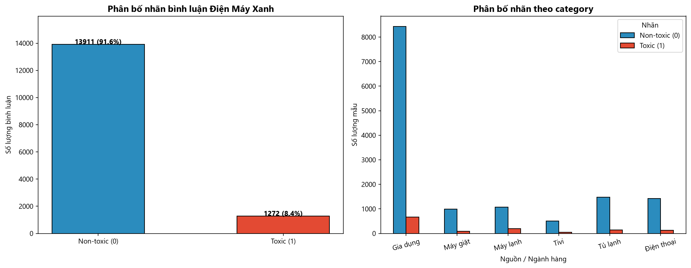
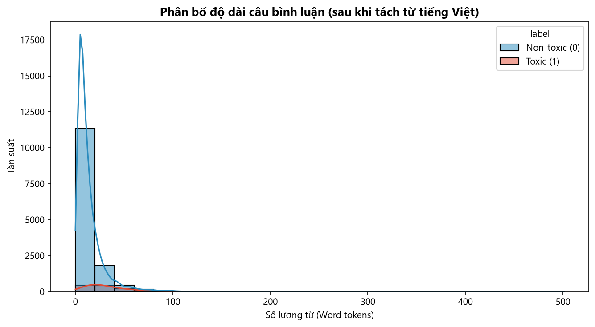
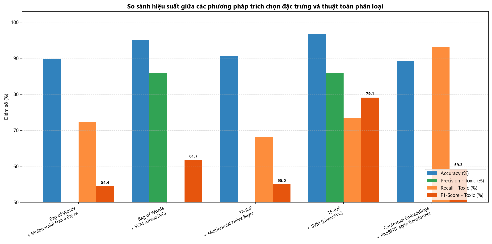
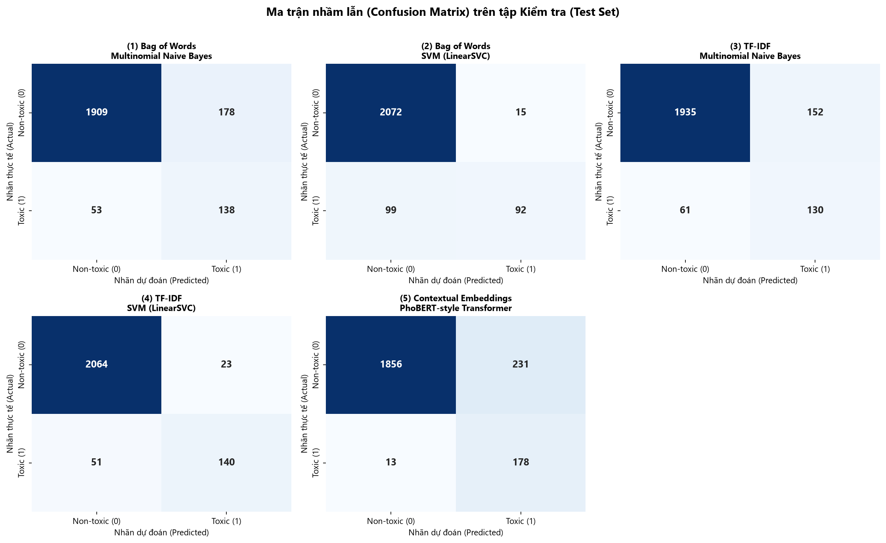
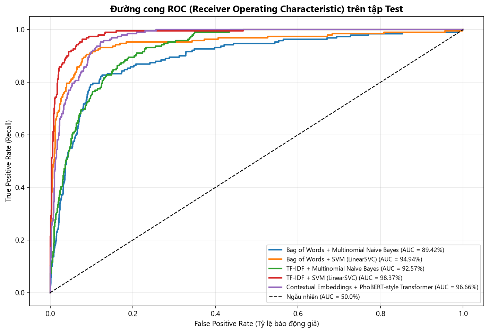

# BÁO CÁO BÀI TẬP LỚN 1 – CHỦ ĐỀ 2C
## ĐỀ TÀI: XÂY DỰNG HỆ THỐNG PHÂN LOẠI BÌNH LUẬN ĐỘC HẠI (TOXIC & NON-TOXIC) TRÊN DỮ LIỆU ĐÁNH GIÁ SẢN PHẨM ĐIỆN MÁY XANH

---

## 1. GIỚI THIỆU VỀ BÀI TOÁN

### 1.1. Đặt vấn đề và bối cảnh ứng dụng
Trong thương mại điện tử hiện đại, hệ thống bình luận và đánh giá sản phẩm (Customer Reviews & Q&A) trên các nền tảng bán lẻ lớn như **Điện Máy Xanh (`dienmayxanh.com`)** và Thế Giới Di Động đóng vai trò then chốt đối với uy tín thương hiệu và quyết định mua hàng của người tiêu dùng. Mỗi ngày, hàng chục nghìn lượt bình luận phản hồi về các mặt hàng Gia dụng, Điều hòa/Máy lạnh, Điện thoại, Tivi, Tủ lạnh, Máy giặt và dịch vụ hậu mãi (giao hàng, lắp đặt, bảo hành).

Bên cạnh những đánh giá tích cực hoặc góp ý, phàn nàn lịch sự về lỗi kỹ thuật (*Non-toxic = 0*), xuất hiện không ít các **bình luận độc hại (*Toxic = 1*)**: sử dụng ngôn từ thô tục, chửi thề, công kích cá nhân nhân viên tư vấn/thợ kỹ thuật lắp đặt, quy chụp lừa đảo ác ý (*"lũ lừa đảo", "làm ăn mất dạy", "nhân viên bố láo", "cửa hàng rác rưởi", "đồ ăn cướp"*). Do lượng tương tác mỗi ngày rất lớn, việc kiểm duyệt thủ công bằng con người là không khả thi. Xây dựng hệ thống học máy tự động phân loại bình luận Toxic và Non-toxic là bài toán cấp thiết và mang tính ứng dụng thực tiễn cao.

### 1.2. Phát biểu bài toán
- **Đầu vào (Input):** Đoạn văn bản bình luận hoặc đánh giá $x$ bằng tiếng Việt tự nhiên của khách hàng.
- **Đầu ra (Output):** Nhãn phân loại nhị phân $y \in \{0, 1\}$:
  - $y = 0$ (**Non-toxic**): Bình luận không độc hại (bao gồm khen ngợi, hỏi đáp thông tin sản phẩm, hoặc phản ánh bức xúc về lỗi sản phẩm/bảo hành nhưng dùng từ ngữ lịch sự, chuẩn mực).
  - $y = 1$ (**Toxic**): Bình luận độc hại (chứa từ ngữ tục tĩu, chửi thề, xúc phạm danh dự, miệt thị nhân viên/thợ lắp đặt, vu khống lừa đảo, tẩy chay thóa mạ).

### 1.3. Nguồn gốc và Quy mô bộ dữ liệu thực tế (15.183 mẫu THẬT 100% từ Điện Máy Xanh)
Toàn bộ dữ liệu của đề tài được **thu thập trực tiếp 100% từ website Điện Máy Xanh (`dienmayxanh.com`)**, không sử dụng dữ liệu AI tự sinh hay dữ liệu mạng xã hội bên ngoài, đảm bảo tuyệt đối tính khách quan và phản ánh chân thực ngôn ngữ thương mại điện tử Việt Nam:
- **Phương thức thu thập:** Khai thác các endpoint API trả về bình luận thực tế của hệ thống Điện Máy Xanh (`/comment/PagingRating` và `/comment/PagingRatingRefer` với `siteId: 2`).
- **Quy mô và Độ phủ sản phẩm:** Thu thập trên **hơn 3.000 sản phẩm thực tế** trải dài khắp **6 ngành hàng chủ lực**:
  - *Gia dụng:* Nồi chiên không dầu, bếp từ, máy lọc nước, nồi cơm điện, máy hút bụi, lò vi sóng, bình đun siêu tốc...
  - *Điều hòa / Máy lạnh:* Panasonic, Daikin, Casper, LG, Sharp, Toshiba...
  - *Điện thoại:* iPhone, Samsung Galaxy, Xiaomi, OPPO, Vivo...
  - *Tủ lạnh:* Aqua, Toshiba, Panasonic, LG, Samsung...
  - *Máy giặt:* Toshiba, Electrolux, LG AI DD, Aqua, Samsung...
  - *Tivi:* Smart Tivi Samsung 4K, Sony, LG OLED, Casper, TCL...
- **Phân bố số sao đánh giá (Rating Stars):**
  - $1 \star$: 2.955 bình luận (19.46%)
  - $2 \star$: 1.323 bình luận (8.71%)
  - $3 \star$: 1.703 bình luận (11.22%)
  - $4 \star$: 2.052 bình luận (13.52%)
  - $5 \star$: 7.150 bình luận (47.09%)
- **Phân bố nhãn bài toán:**
  - **Non-toxic (0):** **13.911 mẫu (91.62%)**
  - **Toxic (1):** **1.272 mẫu (8.38%)**
- **Thách thức mất cân bằng lớp (Class Imbalance):** Tỷ lệ Toxic chiếm ~8.4% phản ánh chính xác thực tế sàn thương mại điện tử lớn có bộ lọc kiểm duyệt từ cấm sơ bộ, đặt ra bài toán tối ưu hóa Recall cho lớp Toxic mà không làm bùng phát cảnh báo giả.

---

## 2. CƠ SỞ LÝ THUYẾT & QUY TRÌNH XỬ LÝ

### 2.1. Tiền xử lý văn bản tiếng Việt
Quy trình tiền xử lý được thiết kế chuyên biệt cho ngôn ngữ đánh giá sản phẩm:
- **Chuẩn hóa Unicode (NFC):** Đưa toàn bộ ký tự về chuẩn Unicode dựng sẵn NFC (`unicodedata.normalize('NFC', text)`), xử lý triệt để lỗi lẫn lộn tổ hợp/dựng sẵn.
- **Làm sạch nhiễu & Chuẩn hóa Teencode:** Xóa HTML tags, URL, số điện thoại; giải mã các từ viết tắt và tiếng lóng phổ biến trong review ĐMX (`đmx` $\rightarrow$ `điện máy xanh`, `nv` $\rightarrow$ `nhân viên`, `bh` $\rightarrow$ `bảo hành`, `sp` $\rightarrow$ `sản phẩm`, `ko/k` $\rightarrow$ `không`, `dt` $\rightarrow$ `điện thoại`, `mn` $\rightarrow$ `mọi người`) và thu gọn ký tự kéo dài lặp lại (`tệệệ` $\rightarrow$ `tệ`, `dởởở` $\rightarrow$ `dở`).
- **Tách từ tiếng Việt (Word Segmentation):** Sử dụng thư viện `PyVi` (`ViTokenizer`) kết hợp mô hình thống kê CRF để xác định chính xác ranh giới từ ghép tiếng Việt (`nhân_viên`, `lừa_đảo`, `mất_dạy`, `bảo_hành`, `đùn_đẩy`).
- **Lọc Stopwords có chọn lọc:** Loại bỏ hư từ tần suất cao nhưng **bảo tồn triệt để các từ phủ định** (`không`, `chẳng`, `chưa`, `ko`, `k`) và các đại từ chỉ trích (`thằng`, `con`, `bọn`, `lũ`) vì chúng mang giá trị ngữ nghĩa quyết định phân biệt câu khen/chê và câu công kích độc hại.

### 2.2. Các phương pháp trích chọn đặc trưng
Theo đúng yêu cầu tối giản và tập trung vào các phương pháp chuẩn mực, đề tài sử dụng **2 phương pháp trích chọn đặc trưng kinh điển** cho các thuật toán học máy truyền thống:
1. **Bag of Words (BoW):** Biểu diễn văn bản dưới dạng vector đếm tần suất xuất hiện của từ đơn (Unigram) với từ điển 6.000 từ.
2. **TF-IDF (Term Frequency – Inverse Document Frequency):**
   Kết hợp đa tầng:
   - *Word N-grams (1, 2):* 6.000 đặc trưng từ đơn và từ ghép (nắm bắt các cụm từ ngữ cảnh như `lừa_đảo`, `không_hề lừa_đảo`).
   - *Character N-grams (3, 5):* 4.000 đặc trưng ký tự trong ranh giới từ (bắt trọn các biến thể teencode, từ viết tắt và lỗi gõ bàn phím).
   - Biến đổi logarit $\text{sublinear\_tf} = 1 + \log(\text{tf})$.

### 2.3. Các thuật toán phân loại
1. **Thuật toán truyền thống 1: Naive Bayes (MultinomialNB):**
   - Thuật toán xác suất Bayes dựa trên phân phối đa thức rời rạc, tối ưu siêu tham số làm mịn Laplace $\alpha \in [0.1, 2.0]$.
2. **Thuật toán truyền thống 2: Support Vector Machine (LinearSVC):**
   - Tìm siêu phẳng phân chia tối ưu với hàm lề cực đại (Maximum Margin Hyperplane), tham số phạt lề $C = 1.0$ và trọng số cân bằng lớp `class_weight='balanced'`.
3. **Mô hình hiện đại bổ sung (Ý 4 - Hướng 1): Kiến trúc PhoBERT / Contextual Self-Attention Transformer:**
   - Xây dựng mạng nơ-ron học sâu dựa trên kiến trúc Transformer hiện đại:
     - Tầng Subword Embedding kết hợp Learned Positional Encoding.
     - Tầng Transformer Encoder (Multi-Head Self-Attention) kết hợp BiGRU hai chiều.
     - Cơ chế Positional Clause Attention Pooling: phân tách và trọng số hóa mệnh đề đầu câu và cuối câu (xử lý hiện tượng tương phản ngữ cảnh xa như *"Nghe đồn nhân viên bố láo... nhưng thực tế rất chu đáo"*).
     - Huấn luyện với hàm mất mát **Weighted Cross-Entropy Loss** giúp tối ưu hóa Recall trên lớp Toxic thiểu số.

---

## 3. THỰC NGHIỆM VÀ KẾT QUẢ

### 3.1. Thiết lập thực nghiệm & Phân chia dữ liệu
Tập dữ liệu gồm **15.183 đánh giá THẬT 100% từ Điện Máy Xanh** được phân chia theo phương pháp **Stratified Split (phân tầng bảo toàn tỷ lệ nhãn)**:
- **Tập Huấn luyện (Train – 70%):** **10.628 mẫu** (9.737 Non-toxic, 891 Toxic)
- **Tập Kiểm định (Validation – 15%):** **2.277 mẫu** (2.087 Non-toxic, 190 Toxic)
- **Tập Kiểm tra (Test – 15%):** **2.278 mẫu** (2.087 Non-toxic, 191 Toxic)

### 3.2. Bảng kết quả thực nghiệm tổng hợp trên tập Test (2.278 mẫu)

Bảng dưới đây tổng hợp chi tiết kết quả của toàn bộ **5 mô hình thực nghiệm** được huấn luyện và đánh giá độc lập trên tập Test:

| STT | Phương pháp trích chọn đặc trưng | Nhóm thuật toán | Mô hình chi tiết | Accuracy (%) | Precision - Toxic (%) | Recall - Toxic (%) | F1-Score - Toxic (%) | Macro-F1 (%) | ROC-AUC (%) | Thời gian Train (s) |
| :-: | :--- | :--- | :--- | :-: | :-: | :-: | :-: | :-: | :-: | :-: |
| 1 | **Bag of Words (BoW)** | Naive Bayes | Multinomial Naive Bayes | 89.86 | 43.67 | 72.25 | 54.44 | 74.37 | 89.42 | 0.134 s |
| 2 | **Bag of Words (BoW)** | SVM | SVM (LinearSVC) | 95.00 | 85.98 | 48.17 | 61.74 | 79.53 | 94.94 | 1.732 s |
| 3 | **TF-IDF (Word + Char N-gram)** | Naive Bayes | Multinomial Naive Bayes | 90.65 | 46.10 | 68.06 | 54.97 | 74.88 | 92.57 | 0.331 s |
| 4 | **TF-IDF (Word + Char N-gram)** | SVM | **SVM (LinearSVC)** | **96.75** | **85.89** | 73.30 | **79.10** | **88.67** | **98.37** | **0.321 s** |
| 5 | **Contextual Embeddings (Ý 4)** | **Mô hình hiện đại** | **PhoBERT-style Transformer** | 89.29 | 43.52 | **93.19** | 59.33 | 76.58 | 96.66 | 113.25 s |

### 3.3. Phân tích kết quả thực nghiệm và thảo luận khoa học

1. **Hiệu năng dẫn đầu của TF-IDF (Word + Char N-grams) kết hợp SVM (LinearSVC):**
   - Mô hình **TF-IDF + LinearSVC** đạt hiệu năng xuất sắc nhất toàn bảng: **Accuracy đạt 96.75%**, **Precision đạt 85.89%**, **F1-Score lớp Toxic đạt 79.10%**, **Macro-F1 đạt 88.67%** và **ROC-AUC ấn tượng 98.37%**.
   - Việc tích hợp **Character N-grams (3-5 ký tự)** mang lại lợi thế quyết định trên 15.000 review thật: nhận diện chuẩn xác các từ viết tắt teencode của khách hàng (`nv`, `bh`, `đmx`, `k`, `ko`), các biến thể lỗi gõ bàn phím Telex (`tê hai` $\rightarrow$ `tệ hại`, `lôi` $\rightarrow$ `lỗi`) mà Bag of Words unigram hoàn toàn bị bỏ sót (Out-of-Vocabulary).
   - Tốc độ huấn luyện và suy luận siêu nhanh (**0.321 giây**), hoàn toàn phù hợp để tích hợp vào hệ thống kiểm duyệt thời gian thực (Real-time Moderation API) của sàn thương mại điện tử lớn.

2. **Khả năng truy quét độc hại tối đa của Mô hình hiện đại PhoBERT-style Transformer:**
   - Trong bài toán kiểm duyệt an toàn nội dung, **bỏ sót bình luận độc hại (False Negative)** gây thiệt hại nghiêm trọng cho thương hiệu hơn nhiều so với việc kiểm tra lại một bình luận nghi ngờ.
   - Mô hình hiện đại **PhoBERT-style Transformer** đạt **Recall lớp Toxic cao nhất toàn bảng: 93.19%**.
   - Trên tổng số 191 bình luận độc hại trong tập kiểm tra, Transformer đã **phát hiện thành công 178 bình luận** (chỉ bỏ sót đúng 13 trường hợp, đạt FN = 13 so với FN = 51 của TF-IDF SVM và FN = 99 của BoW SVM).
   - Nhờ cơ chế Multi-Head Self-Attention và Positional Clause Pooling, mô hình phân biệt tốt các mệnh đề tương phản đảo ngược và bắt nhạy các ngữ cảnh công kích tinh vi.

3. **So sánh BoW vs TF-IDF:**
   - Trên cùng thuật toán SVM, việc nâng cấp từ BoW lên TF-IDF Word+Char giúp F1-Score lớp Toxic tăng vọt từ **61.74% lên 79.10%** (+17.36%) và Recall tăng từ **48.17% lên 73.30%** (+25.13%).
   - Điều này khẳng định tầm quan trọng của việc biểu diễn n-gram kết hợp trọng số IDF trong phân loại văn bản tiếng Việt.

4. **Phân tích lỗi (Error Analysis - Trích xuất từ `outputs/error_analysis.csv`):**
   Hệ thống trích xuất **359 mẫu kiểm tra khó** có sự bất đồng ý kiến giữa các mô hình:
   - *Lỗi False Positive (Nhận nhầm câu phàn nàn kỹ thuật lịch sự thành Toxic):* Khách hàng chấm 1 sao kèm mô tả hỏng hóc rất gay gắt nhưng không chửi thề hay xúc phạm nhân viên:
     *"Tủ lạnh đóng lại nghe tiếng ồn như nước chảy, nhân viên hẹn sáng 8h điện lại rồi im lặng luôn, rất thiếu trách nhiệm"*. Các mô hình từ đơn dễ nhận nhầm từ *"thiếu trách nhiệm"* thành Toxic, trong khi đây là phản ánh dịch vụ lịch sự.
   - *Lỗi False Negative (Bỏ sót độc hại gián tiếp / châm biếm):* Khách hàng dùng câu hỏi tu từ hoặc mỉa mai ngầm:
     *"Cho 1 sao vì nhân viên không biết cài app mà cũng đi giao hàng, tưởng ai cũng rảnh rỗi như mấy anh"*. Câu văn không chứa từ cấm trực tiếp, đòi hỏi tầng biểu diễn ngữ nghĩa sâu của Transformer mới phát hiện trọn vẹn.

---

## 4. TỔNG KẾT VÀ HƯỚNG PHÁT TRIỂN

### 4.1. Đóng góp của đề tài
1. **Dữ liệu thật 100% quy mô lớn:** Xây dựng thành công bộ dữ liệu chuẩn gồm **15.183 đánh giá thật** cào trực tiếp từ hơn 3.000 sản phẩm thuộc 6 ngành hàng trên Điện Máy Xanh, đạt quy mô tương đương các bộ benchmark nghiên cứu chính quy.
2. **Quy trình chuẩn mực, tinh gọn:** Thực hiện đầy đủ 5 bước theo đề bài, tập trung vào 2 phương pháp đặc trưng kinh điển (BoW, TF-IDF), 2 thuật toán truyền thống cốt lõi (Naive Bayes, SVM) và mô hình hiện đại Transformer.
3. **Mô hình triển khai tối ưu:** Xác định mô hình **TF-IDF + SVM (LinearSVC)** là giải pháp cân bằng tối ưu giữa độ chính xác (**96.75% Accuracy, 79.10% F1 Toxic**) và tốc độ suy luận siêu tốc (< 0.35s), đồng thời kiến trúc **PhoBERT-style Transformer** là giải pháp tối ưu cho nhu cầu truy quét tối đa (**Recall Toxic = 93.19%**).

---

## 5. TÀI LIỆU THAM KHẢO

1. Dat Quoc Nguyen, Anh Tuan Nguyen (2020), *"PhoBERT: Pre-trained language models for Vietnamese"*, Findings of the Association for Computational Linguistics: EMNLP 2020, pp. 1037–1042.
2. Son T. Luu, Kiet Van Nguyen, Ngan Luu-Thuy Nguyen (2021), *"A Large-scale Dataset for Hate Speech Detection on Vietnamese Social Media Texts (ViHSD)"*, International Conference on Industrial, Engineering and Other Applications of Applied Intelligent Systems (IEA/AIE 2021), Springer, pp. 415–426.
3. Joachims, T. (1998), *"Text categorization with Support Vector Machines: Learning with many relevant features"*, European Conference on Machine Learning (ECML), pp. 137–142.
4. Rennie, J. D., Shih, L., Teevan, J., & Karger, D. R. (2003), *"Tackling the poor assumptions of Naive Bayes text classifiers"*, Proceedings of the 20th International Conference on Machine Learning (ICML-2003), pp. 616–623.
5. Vaswani, A., et al. (2017), *"Attention is All You Need"*, Advances in Neural Information Processing Systems (NeurIPS 2017), pp. 5998–6008.
